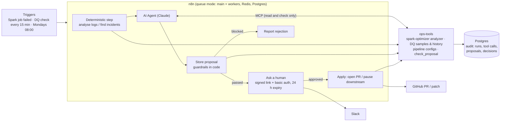

# data-platform-ops-agent

[](https://github.com/satyaprakashdwivedi/data-platform-ops-agent/actions/workflows/ci.yml)

An agentic on-call assistant for a data platform, built to run in production rather than as a demo.
**n8n** orchestrates the workflows and a **Claude** agent does the reasoning. The agent's tools are served over
**MCP**: the [Spark optimizer](https://github.com/satyaprakashdwivedi/spark-optimizer-skill) for failed or wasteful
Spark jobs, and data quality signals from the
[streaming pipelines](https://github.com/satyaprakashdwivedi/spark-streaming-pipeline).

The design rule: **the LLM never does the maths and never changes anything on its own.**
Deterministic tools produce the numbers and the agent decides which ones matter and explains why.
Guardrails in code reject unsafe proposals, a person approves, and only then does a workflow step open
the pull request.



## What it does

| Workflow | Trigger | The agent... | A human approves... |
|---|---|---|---|
| **Spark failure triage** | `POST /webhook/spark-job-failed` from the scheduler (Airflow, cron, Databricks job hook) | reads the spark-optimizer analysis (heap OOM vs container kill, skew, spill, idle executors) and picks the smallest grounded config change | a PR against `pipelines/<job>.yaml` |
| **Data quality incident** | every 15 min, or `POST /webhook/check-quality-now` | samples the quarantined rows and failure history, then classifies the incident as a schema change, data defect, over-strict rule or transient spike | pausing downstream consumers, opening an incident, or relaxing a threshold (never the rule's SQL) |
| **Weekly tuning review** | Mondays 08:00 | turns the ranked idle core-hours into a short Slack review | nothing (read-only) |
| **Error handler** | any workflow fails | (no agent) alerts with the failing node and error, and closes the audit run as `failed` | |

Example from the demo data. The analyzer sees YARN killing an 8g executor (`9.1 GB of 8.8 GB used`) during a
skewed join. The agent proposes `memoryOverhead=2048m`, AQE and skew-join handling, and specifically **not**
more heap, because a container kill is off-heap memory. After approval it opens this change:

```diff
-  spark.sql.adaptive.enabled: "false"
+  spark.sql.adaptive.enabled: "true"
+  spark.executor.memoryOverhead: 2048m
+  spark.sql.adaptive.skewJoin.enabled: "true"
```

## Why it can go to production

- **Grounded tools.** The agent receives the
  [spark-optimizer](https://github.com/satyaprakashdwivedi/spark-optimizer-skill) analysis, and a proposal may only
  use keys the analyzer recommended (`must_be_grounded`). CI checks that the vendored analyzer matches its
  pinned upstream commit.
- **Guardrails in code, not in the prompt.** [`config/policy.yaml`](config/policy.yaml) defines:
  - the allow-listed Spark keys, with min and max values;
  - at most a 3x change per step;
  - a maximum container size (heap + overhead + PySpark) and maximum total cores;
  - plain-value checks that block `--conf` injection;
  - quality actions limited to an allow-list.

  Rejected proposals are stored with their reasons and never reach an approver.
- **Least-privilege agent.**
  - Over MCP the agent gets only read-and-check tools (`analyze_spark_job`, `get_pipeline_config`,
    `sample_failed_rows`, `get_failure_history`, `check_proposal`).
  - Creating, approving and applying changes are deterministic workflow steps.
  - A test fails the build if an agent node is given any other tool, or if an apply step can be reached
    without going through `Approved?`.
- **Human in the loop.**
  - Approval links are n8n's signed resume URLs behind basic auth. They expire after 24 hours, and an
    expired proposal cannot be approved.
  - The approver is recorded on the proposal and in the PR description.
- **Idempotent and retry-safe.**
  - A repeated alert reuses the open proposal instead of paging twice.
  - `apply` on an applied proposal returns the existing PR.
  - HTTP steps retry with backoff.
- **Full audit trail.** Every run, every tool call (REST or MCP, with arguments, duration and errors),
  analysis, proposal, decision and notification is stored in Postgres (`ops.*`).
- **Production n8n topology.**
  - Queue mode: the main process handles UI and webhooks, and workers execute.
  - Redis and Postgres back n8n, and executions are retained for 30 days.
  - An error workflow covers every workflow.
  - Each service has its own database role, and secrets come only from the environment.
- **Workflows as code.** [`n8n/build_workflows.py`](n8n/build_workflows.py) generates the workflow JSON from
  Python and the prompts in [`n8n/prompts/`](n8n/prompts). Diffs are reviewable, and CI fails on stale JSON
  or anything that looks like a secret.
- **Hermetic end-to-end test in CI.**
  - GitHub Actions boots the whole stack with `docker compose`.
  - n8n's Anthropic credential points at a scripted model ([`stub_llm.py`](ops-tools/src/ops_tools/testing/stub_llm.py)),
    and every workflow is driven through its real webhooks.
  - Each run approves one Spark fix, declines another, approves a data quality pause and checks the
    database afterwards.
  - Everything except the model's judgement runs for real: n8n, MCP, the guardrails, the approval wait
    and the PR step.

## Quick start

Requires Docker with Compose v2.

```bash
./scripts/init_env.sh              # writes .env with random secrets
# put your key in .env: ANTHROPIC_API_KEY=...   (model: ANTHROPIC_MODEL, default claude-sonnet-5-5)
docker compose up -d --build
./demo/run_demo.sh                 # triggers all three workflows and prints the approval links
```

- **n8n UI:** http://localhost:5678. Create the owner account on first visit; the five workflows are already
  imported and published.
- **Approve or decline:** open a link that `run_demo.sh` prints and log in with `APPROVER_USER` /
  `APPROVER_PASSWORD` from `.env`.
- **Where approved Spark changes go:** without `GITHUB_TOKEN`, they land in `./outbox/*.patch`. With
  `GITHUB_TOKEN` and `GITHUB_REPO` set, they become real pull requests.

To run the stack without an API key, use the scripted model the CI uses:

```bash
./scripts/init_env.sh tests/e2e/.env.test
docker compose --env-file tests/e2e/.env.test --profile test up -d --build
python3 tests/e2e/run_e2e.py tests/e2e/.env.test
```

## Connecting it to a real platform

| What | How |
|---|---|
| Spark logs | `SPARK_HISTORY_SERVER_URL`: the event log is pulled from `/api/v1/applications/<id>/logs`. Alternatively, mount a log directory with `SPARK_EVENT_LOG_HOST_DIR` (`<dir>/<app id>/` containing the event log plus stderr). |
| Job failures | Have the scheduler POST `{"app_id": "...", "pipeline": "..."}` to `/webhook/spark-job-failed` with the `X-Webhook-Token` header. |
| Quality results | Streaming pipelines write `dq.check_result` (per rule, per micro-batch) and their `_quarantine` output to `dq.quarantine_row` through a JDBC sink. The [Java](https://github.com/satyaprakashdwivedi/spark-streaming-pipeline) and [PySpark](https://github.com/satyaprakashdwivedi/spark-streaming-pipeline-py) pipeline repos have both. |
| Pull requests | A fine-grained `GITHUB_TOKEN` with contents and pull-request write access to the config repo only. |
| Notifications | `SLACK_WEBHOOK_URL`. Approval links become Slack buttons. |
| Downstream pausing | Consumers check `ops.pipeline_control.paused` before reading a pipeline's output. |

The same tools work from Claude Code or Claude Desktop, for ad-hoc investigation:

```bash
claude mcp add --transport http ops-tools http://localhost:8000/mcp --header "Authorization: Bearer $OPS_TOOLS_TOKEN"
```

## Repository layout

```
docker-compose.yml        n8n main + workers, Redis, Postgres, ops-tools, stub model (test profile)
config/policy.yaml        guardrails: allowed keys, limits, change factor, quality actions, approval expiry
pipelines/                Spark job configs and quality rules the agent proposes changes to
n8n/build_workflows.py    workflows as code -> n8n/workflows/*.json
n8n/prompts/              system and task prompts for each agent
n8n/init/                 credential + workflow import at start-up (secrets from env only)
ops-tools/                FastAPI REST + MCP server (Python 3.12)
  src/ops_tools/          service, guardrails, spark_analysis, quality, github_pr, mcp_server, api
  src/ops_tools/vendor/   spark-optimizer analyzer, pinned to an upstream commit
  tests/                  guardrails, config edits, diagnosis, DB lifecycle, workflow lint
db/                       schema (audit, proposals, DQ tables) and per-service roles
demo/                     three Spark apps (container kill, heap OOM, idle executors) + a DQ schema change
tests/e2e/run_e2e.py      drives every workflow through the real stack
```

## Related

- [spark-optimizer-skill](https://github.com/satyaprakashdwivedi/spark-optimizer-skill): the analyzer behind
  `analyze_spark_job`, also usable as a Claude skill.
- [spark-streaming-pipeline](https://github.com/satyaprakashdwivedi/spark-streaming-pipeline) and
  [spark-streaming-pipeline-py](https://github.com/satyaprakashdwivedi/spark-streaming-pipeline-py):
  config-driven streaming pipelines with quality rules and quarantine outputs.

MIT licensed.
